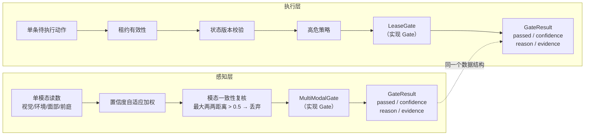
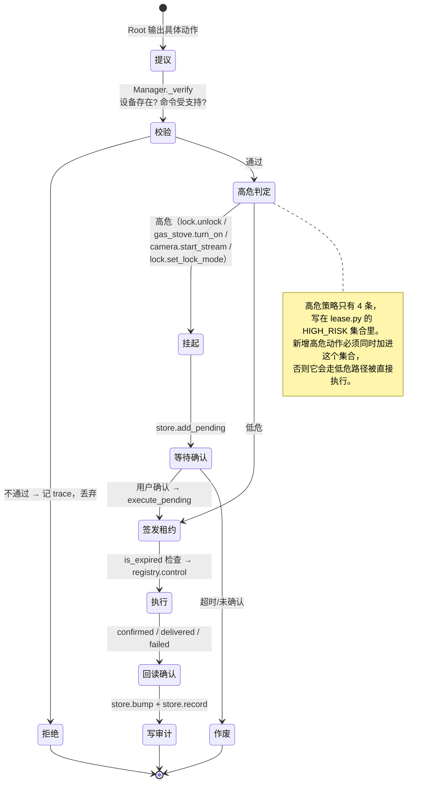
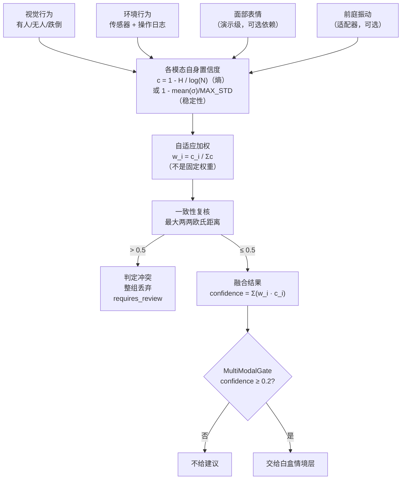
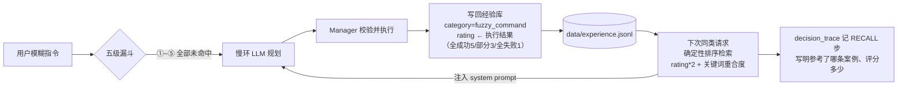

# 灵犀 2.0 · 架构图集

> 本文件是全部架构图的**单一出处**。白皮书、申报书、答辩 PPT 里的架构图都应引用本文件，
> 不要各自复制一份 —— 复制出来的图会各自漂移，最后没有人知道哪张是真的。
>
> 每张图下面的说明都是**可在代码里验证的**，并给出对应的文件与守门测试。
> 图与代码不一致时以代码为准，并回来修图。

---

## 图 1：L0–L8 分层架构（全貌）

```mermaid
graph TB
    subgraph L0["L0 接入层"]
        REST["REST API<br/>/api/*"]
        WS["WebSocket<br/>/ws"]
        MCP["MCP Server<br/>POST /mcp"]
        CH["多渠道<br/>channels.py<br/>HTTP/Webhook/MQTT"]
    end

    subgraph L1["L1 治理层（可观测性）"]
        RL["rate_limit.py<br/>IP 滑窗限流<br/>普通 300/min · LLM 10/min"]
        AL["api_log.py<br/>端点/状态码/延迟"]
        LL["llm_log.py<br/>模型调用 + 决策分层延迟"]
        EC["edge_cloud.py<br/>隐私分级 L0/L1/L2"]
    end

    subgraph L2["L2 感知层 ★"]
        PS["perception/service.py<br/>模态 → 融合 → 门控 → 询问式建议"]
        FUS["fusion.py<br/>置信度熵 + 自适应加权<br/>+ 一致性复核"]
        MG["modal_gate.py<br/>MultiModalGate"]
        SIT["situation.py<br/>5 个白盒情境参数"]
        MOD["modalities/<br/>视觉行为 / 环境行为<br/>面部表情 / 前庭"]
    end

    subgraph L3["L3 决策层"]
        FUN["五级意图漏斗<br/>①空输入 ②场景 ③技能<br/>④能力契约 ⑤设备正则"]
        ROOT["agents/root_agent.py<br/>Root：只提议、只授权"]
        SLOW["慢环 LLM<br/>单次输出具体动作<br/>llm_budget 限次/限时"]
        MGR["agents/manager_agent.py<br/>Manager：校验/授权/执行<br/>**不持有 LLM**"]
    end

    subgraph L4["L4 工具层"]
        TK["toolkit/<br/>schema_gen · registry · guard"]
    end

    subgraph L5["L5 护栏层"]
        GATE["gate.py<br/>★ Gate 抽象"]
        LEASE["lease.py<br/>租约 + 高危策略<br/>+ LeaseGate"]
        ST["state.py<br/>单一真相源<br/>版本/审计/pending"]
        EVR["event_routes.py<br/>声明式事件路由<br/>高危默认拒绝"]
    end

    subgraph L6["L6 执行层"]
        REG["devices/registry.py<br/>control() + 回读三态<br/>confirmed/delivered/failed"]
        TWIN["孪生同步<br/>虚拟预期态 ↔ 实体实测态"]
    end

    subgraph L7["L7 记忆层 ★"]
        MAN["manuals.py<br/>设备手册"]
        HAB["habits.py<br/>习惯 + 偏好一致性"]
        EXP["experience.py<br/>成功案例回灌"]
    end

    subgraph L8["L8 调度层（快慢双环）"]
        INNER["内环（零 LLM）<br/>2s 状态 / 5s 告警 / 15s 感知"]
        OUTER["外环<br/>jobs/daily_summary.py<br/>22:00 日报"]
    end

    L0 --> L1 --> L2
    L1 --> L3
    L3 --> L4 --> L5 --> L6
    L7 -.->|注入 prompt| L3
    L8 --> INNER
    L8 --> OUTER
    OUTER -.->|读审计/感知/记忆| L6
    OUTER -.-> L7

    style L2 fill:#1f2e28,stroke:#2c4a3d
    style L7 fill:#2a2438,stroke:#4a3d6e
    style L8 fill:#2a3446,stroke:#35506e
```

**关键接缝**：`toolkit/guard.py` 是 L4↔L5 的唯一接缝，也是「LLM 无法绕过护栏」的物理保证。
LLM 选错设备或越界参数，结果是**被拒绝**，不是**被执行**。

---

## 图 2：统一门控抽象 —— 全部架构叙事里最该讲的一张

> **同一句设计原则贯穿感知层与执行层：不信任单一信号源。**
>
> 这不是修辞上的类比 —— 两侧在代码里共用同一个 `Gate` 接口（`backend/gate.py`）。

| 层 | 单一信号源的风险 | 门控机制 | 冲突时的行为 |
|---|---|---|---|
| 感知层 | 单模态误判（光照导致面部误判等） | 置信度自适应加权 + 模态一致性复核 | **整组结果丢弃**，标记不一致 |
| 执行层 | LLM 幻觉 / 越权 / 重放 | 授权租约 + 状态版本校验 + 高危二次确认 | **拒绝执行**，写审计 |

**为什么值得单独做一层抽象**：两处门控的失败处理逻辑（记录 evidence → 降级 → 通知）
因此可以统一，且答辩时"同构"这个说法**有代码支撑而不是口头类比**。
`tests_perception.py` 第 6 节断言 `MultiModalGate` 与 `LeaseGate` 都实现 `Gate` 接口、
都返回 `GateResult`。

> **一处有意识的偏离**：心镜在"两者置信度都极低"时把置信度设为 `0.5`，
> 等于从零信息里凭空造出一个中等置信度的结果，然后照常参与决策。
> 本项目改为**零信息即零置信度并拒绝**（见 `fusion.py` 模块头与
> `tests_perception.py` 的零输入断言）。

---

## 图 3：五级意图漏斗（规则层 <10ms 的保证）

```mermaid
graph TB
    IN["用户输入"] --> C1{"① 空输入 / 无意义?"}
    C1 -->|是| FB1["诚实兜底话术"]
    C1 -->|否| C1b{"①b 条件句?<br/>同时含条件词与结果词"}
    C1b -->|是| FB2["诚实拒绝<br/>（要的是建自动化规则，<br/>不是立即动作）"]
    C1b -->|否| C2{"② 场景规则<br/>SCENES 10 个"}
    C2 -->|命中| HIT["TaskPlan(source=rule)"]
    C2 -->|未命中| C3{"③ 技能触发词<br/>skills.py"}
    C3 -->|命中| HIT
    C3 -->|未命中| C4{"④ 能力契约别名<br/>capabilities.json"}
    C4 -->|命中| HIT
    C4 -->|未命中| C5{"⑤ 设备指令正则<br/>（宽泛兜底）"}
    C5 -->|命中| HIT
    C5 -->|未命中| C6{"⑥ 允许上云?"}
    C6 -->|否| FB1
    C6 -->|是| SLOW["慢环 LLM<br/>（唯一会触达模型的位置）"]

    style SLOW fill:#3a2a12,stroke:#6b4d15
    style HIT fill:#1f2e28,stroke:#2c4a3d
```

**顺序不可随意调换 —— 按"精确 → 宽泛"排列。** 实测过的反例：设备正则
`窗帘.*(开|拉开)` 若排在能力契约之前，会把「窗帘开一半」抢成全开
（能力契约给的是 `position=50`）。规则越宽泛必须越靠后。

**红线保证**：①~⑤ 全部在 `RootAgent.plan()` 内**同步**完成，物理上不可能触达 LLM。
`tests_funnel.py` 把这条钉住（含静态扫描）。

**实测**：漏斗解析 avg 0.059ms / p95 0.359ms（25 条输入 × 200 轮，5000 样本）。
端到端 `decide()`（含执行与审计）avg 8.46ms / p95 20.59ms。数据来源见 `docs/BENCH.md`。

---

## 图 4：授权租约与高危策略

**租约的参数包络（envelope）尚未实现（缺陷 D7）—— 这是当前已知的护栏缺口。**
现行 `_execute` 用 `is_expired` 而非完整 `verify`，原因见 `CLAUDE.md` 与方案文档
阶段 2 的陷阱说明（`lease.py:99-101` 的 docstring 已记录）。不要把它当成已完成。

**D22 已修**：`/api/tools/call` 与 MCP `tools/call` 此前直接调 `registry.control()`，
实测可解锁门锁、点燃燃气灶。现改为工具调用包装成单动作 `TaskPlan` 交给同一个
`ManagerAgent`，**对话路径与工具路径共用同一条链**。

**D23 已修**：事件路由是无人确认路径，此前同样直接调 `registry.control()`。
现默认拒绝高危动作，需在配置里显式写 `"allow_high_risk": true`。

---

## 图 5：快慢双环

```mermaid
graph LR
    subgraph INNER["内环（秒级 · 零 LLM）"]
        S["sensor_loop<br/>2s<br/>状态广播 + 喂感知/采样"]
        A["alert_loop<br/>5s<br/>声明式阈值判定"]
        P["perception_loop<br/>15s<br/>多模态融合评估"]
    end

    subgraph OUTER["外环（每日一次 · LLM 优先）"]
        D["daily_summary<br/>22:00<br/>日报生成"]
    end

    S --> A
    A -->|"结构化事件"| EV["EventRouter<br/>联动 + 播报"]
    P -->|"仅询问式建议"| UI["前端"]
    D -->|"facts 来自"| AUD["StateStore 审计日志"]
    D -->|"facts 来自"| SER["SensorSeries<br/>每 30s 采样"]
    D -->|"facts 来自"| MEM["记忆三源"]
    D --> UI

    style INNER fill:#1f2e28,stroke:#2c4a3d
    style OUTER fill:#3a2a12,stroke:#6b4d15
```

| 环 | 周期 | 是否调 LLM | 失效后果 |
|---|---|---|---|
| 内环 | 2–15s | **绝不** | 灯没开 → 用户立刻察觉 |
| 外环 | 每日一次 | LLM 优先 / 模板降级 | 日报没生成 → 用户第二天才注意 |

**这个差别的直接后果是：外环可以用大模型，内环不行。** 内环调模型的延迟与不可用风险
会直接变成"灯按了没反应"，而外环最坏情况只是回退到模板文案。

周期参数全部外置在 `config/loops.json`。演示时改 `outer_loop.cron_hour` 就能现场触发
日报，不必等到 22:00。

---

## 图 6：多模态置信度融合（感知层核心算法）

**与心镜的差异**：心镜的融合在固定 V-A 二维空间、二模态；本项目**推广到 N 模态**
（一致性复核从"两点距离"改为"最大两两距离"，两模态时与心镜完全等价）。

**零信息处理（有意识偏离）**：所有模态置信度均接近 0 时返回
`confidence=0.0, consistent=False`，理由是"无可用依据，不制造中间值"。
心镜此处会回退到 0.5。

---

## 图 7：经验复用闭环

**三条必须讲清楚的边界**：

1. 这叫「**基于成功案例的 prompt 级经验复用**」，**不叫「自进化」/「自学习」**。
   没有梯度更新、没有策略迭代，只是把历史成功案例放进 prompt。
2. `rating` 默认**由执行结果推导**，衡量的是"这轮规划**执行**成功了吗"，
   **不是"用户满意吗"**。满意度只能靠 `POST /api/memory/feedback` 的显式反馈，
   返回体的 `rating_source` 字段如实区分 `auto_execution` 与 `user`。
3. **确定性排序，不是随机抽样**。心镜用 `random.sample`，导致同一请求每次注入不同
   案例 —— 输入相同、注入不同，「自进化有没有用」这个问题在那种实现下**无法被验证**。
   本项目同样输入永远同样输出，`tests_memory.py` 有守门断言。

---

## 图 8：内环告警 vs 感知层 —— 性质不同，不是同一件事

> 这是答辩最容易被追问、也最容易自相矛盾的地方，因此单独画一张。

| | 内环告警 | 感知层 |
|---|---|---|
| 输入 | 传感器读数（物理量） | 多模态**统计推断** |
| 判定 | 读数直接比大小，确定性 | 置信度融合 + 情境分类 |
| 阈值 | 在 `config/alert_routes.json`，任何人可复核 | 权重可查，但**结论是推断** |
| 失效模式 | 传感器坏了 → 读数明显离谱 | 不透明（单模态误判、模态冲突） |
| 能否触发设备动作 | **能**（走 EventRouter，可审计） | **绝不能**（红线 1） |

**这一页要能当场答上来。** "既然环境告警能自动开空调，为什么情绪判断不能自动调灯？"
—— 答不上来，红线 1 就会显得像自相矛盾，而不是一条设计约束。
